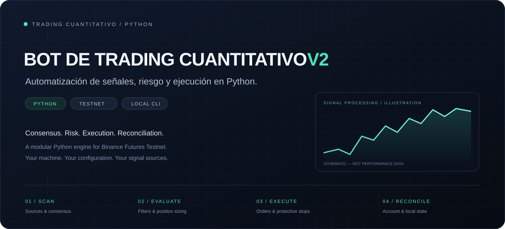
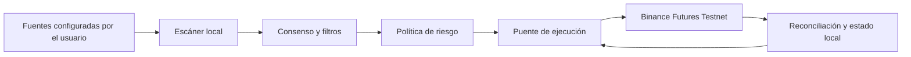

# Bot de Trading Cuantitativo V2

<p align="center">
  
</p>

<p align="center">
  <strong>Un motor de trading modular, desde la señal hasta la reconciliación.</strong><br>
  Python · Binance Futures Testnet · Ejecución local
</p>

<p align="center">
  <a href="#inicio-rápido">Empezar</a> ·
  <a href="#arquitectura">Arquitectura</a> ·
  <a href="#mapa-del-código">Explorar el código</a> ·
  <a href="#estado-y-verificación">Verificación</a>
</p>

---

Bot de Trading Cuantitativo V2 es un motor de trading escrito en Python que transforma señales de consenso en decisiones de ejecución, con cálculo del tamaño de posición, stops y seguimiento del estado de la cuenta. El proyecto original se desarrolló para operar en **Mainnet**. Esta edición pública es una adaptación que funciona localmente y está limitada a **Binance Futures Testnet**.

<table>
<tr>
<td width="33%" valign="top"><h3>01 · Señales</h3><p>Consenso de fuentes configurables, caché local y filtros antes de la entrada.</p></td>
<td width="33%" valign="top"><h3>02 · Riesgo</h3><p>Tamaño de posición, apalancamiento y límites de exposición desde una política compartida.</p></td>
<td width="33%" valign="top"><h3>03 · Ejecución</h3><p>Órdenes, stops y reconciliación del estado con el exchange.</p></td>
</tr>
</table>

## De un vistazo

| Componente | Responsabilidad |
| :--- | :--- |
| Escáner | Lectura de fuentes y generación de consenso. |
| Política | Confirmaciones mínimas, riesgo y apalancamiento. |
| Ejecución | Cantidades, órdenes y protecciones de posición. |
| Contabilidad | Conciliación y seguimiento de cierres. |
| Runtime | Persistencia, exclusión mutua y estado del proceso. |

El proyecto conserva la separación entre señales, reglas y ejecución. Incluye controles de exposición, filtros contra perseguir el precio, tiempos de espera y reconciliación antes de operar.

## Arquitectura



Esta distribución contiene **solo el bot**. No incluye panel, servidor web, autenticación de usuarios, dominio ni despliegue público. El escáner entrega el consenso directamente al motor; no necesita un servicio HTTP intermedio.

## Inicio rápido

Requiere **Python 3.10 o superior**.

```sh
git clone https://github.com/javierandressm/bot-trading-cuantitativo-v2.git
cd bot-trading-cuantitativo-v2
python -m venv .venv
```

Activa el entorno:

```powershell
# Windows PowerShell
.venv\Scripts\Activate.ps1
```

```sh
# macOS / Linux
source .venv/bin/activate
```

Instala la dependencia:

```sh
python -m pip install -r requirements.txt
```

1. Copia `.env.example` a `.env` y añade tus propias claves de **Binance Futures Testnet**.
2. Revisa `antigravity_config.json`. La configuración inicial tiene `network.testnet: true`; el cliente rechaza Mainnet.
3. Configura tus propias fuentes en las plantillas `TRADERS_SELECCION_*.json`. Se entregan vacías: sin fuentes no habrá entradas nuevas.
4. Ejecuta el motor:

```sh
python binance_autonomous_bot.py
```

Una vez configurado, el motor puede enviar órdenes a **Testnet**. Al arrancar espera las condiciones de credenciales, datos y reconciliación necesarias. El primer escaneo puede tardar; no se incluyen señales precargadas.

<details>
<summary><strong>Mapa del código · abrir estructura</strong></summary>

## Mapa del código

```text
bot-trading-cuantitativo-v2/
├── binance_autonomous_bot.py     # Bucle principal
├── binance_execution_bridge.py   # Sizing, órdenes y protecciones
├── binance_futures_client.py     # REST, firmas y límites de API
├── live_whale_scanner.py         # Escáner y caché de consenso
├── lighter_source.py            # Fuente opcional
├── antigravity_policy.py        # Política de riesgo
├── antigravity_accounting.py    # Contabilidad y reconciliación
├── antigravity_config.json      # Parámetros de ejemplo
├── antigravity_*.py             # Filtros y módulos de soporte
├── .env.example                # Variables vacías
└── requirements.txt
```

</details>

## Datos y configuración

No se distribuyen credenciales, identidades de billeteras, historiales de operaciones, usuarios, sesiones ni bases de datos. El bot genera estado y logs en el equipo donde se ejecuta; `.gitignore` excluye esos archivos.

Las direcciones de API de Binance, Hyperliquid y Lighter permanecen porque son servicios públicos utilizados por las integraciones. La copia no incluye infraestructura personal de producción.

## Estado y verificación

- Los **18 módulos Python** pasaron análisis sintáctico estático.
- Se revisaron las dependencias y la eliminación del servidor intermedio de señales.
- Dos revisiones independientes inspeccionaron la copia pública y su paquete en busca de datos privados.
- **No se ejecutaron operaciones contra una cuenta Testnet durante la preparación de esta edición.** La integración completa requiere validación con las claves y fuentes de quien la utilice.

La presencia de controles no demuestra rentabilidad. No se atribuyen resultados históricos al código publicado.

## Procedencia

Adaptación del motor V2 a partir de snapshots anteriores a los cambios de V3 del 13 de noviembre de 2026, junto con los módulos de soporte disponibles al preparar la copia. No es una reconstrucción exacta de un release histórico.

## Licencia

Todavía no se ha seleccionado una licencia de redistribución. Publicar el código permite revisarlo; no concede por sí mismo una licencia de uso o redistribución.

---

<p align="center"><strong>BOT DE TRADING CUANTITATIVO V2</strong><br><sub>Local execution. Explicit risk. Observable state.</sub></p>
